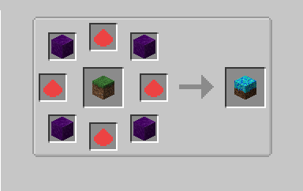
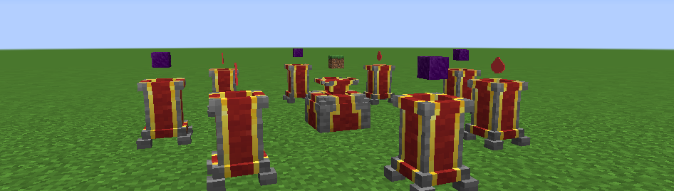
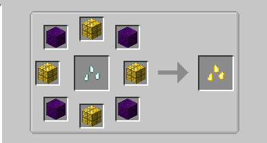
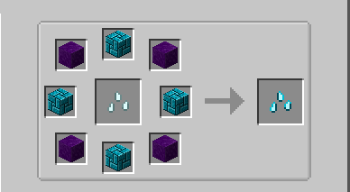
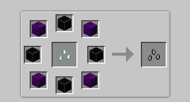
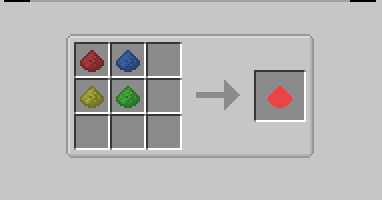

# Farming

Solarite, Emberite and Titanium can be **grown**, Mystical Agriculture style: plant the seeds on **Blue Soil**, harvest
essence and turn it into nuggets.

## Blue Soil

{ .mc-inline } `titanutilities:blue_soil`

Part of **Titan Utilities**. The only block the essence crops grow on (not farmland or grass): the crops accept any block in the `#titanores:essence_crop_soil` block tag, which Titan Utilities fills with Blue Soil. Mine it with a shovel.

Made on the Mystical Agriculture **Infusion Altar**: Grass Block on the altar, 4 Insanium Blocks + 4 Eternal Dust on
the pedestals (recipe added by the modpack with KubeJS).

| What you need | Amount | Where |
|---|---|---|
| Grass Block | 1 | on the altar |
| Insanium Block | 4 | pedestals |
| { .mc-inline } [Eternal Dust](#eternal-dust) | 4 | pedestals |
| Infusion Crystal (or Master Infusion Crystal) | — | right-click the altar to start |

## Seeds

Made on the Mystical Agriculture **Infusion Altar** (recipes added by the modpack with KubeJS): a **Prosperity Seed
Base** on the altar, **4 Insanium Blocks** and **4 blocks of the ore** on the pedestals (alternating).

| Seed | On the altar | Pedestals |
|---|---|---|
| { .mc-inline } Solarite Seeds | Prosperity Seed Base | 4 Insanium Blocks + 4 { .mc-inline } Solarite Blocks |
| { .mc-inline } Emberite Seeds | Prosperity Seed Base | 4 Insanium Blocks + 4 { .mc-inline } Emberite Blocks |
| { .mc-inline } Titanium Seeds | Prosperity Seed Base | 4 Insanium Blocks + 4 { .mc-inline } Titanium Blocks |

=== "Solarite"
    

=== "Emberite"
    

=== "Titanium"
    

## Crops

| Seeds | Crop | Harvest (mature) |
|---|---|---|
| { .mc-inline } Solarite Seeds | `titanores:solarite_crop` | 1 { .mc-inline } Solarite Essence + 1 seed back (+25% chance of an extra seed) |
| { .mc-inline } Emberite Seeds | `titanores:emberite_crop` | 1 { .mc-inline } Emberite Essence + 1 seed back (+25% chance of an extra seed) |
| { .mc-inline } Titanium Seeds | `titanores:titanium_crop` | 1 { .mc-inline } Titanium Essence + 1 seed back (+25% chance of an extra seed) |

- Crops have 8 growth stages and need light, like wheat, but grow **slower** (about 45 minutes on average).
- Breaking an unripe crop only gives the seed back.
- **Bone meal does not work.** Special growth items and accelerators from other mods (for example Mystical
  Agriculture's Fertilized Essence and Growth Accelerators) do.

## Botany Pots

The seeds also grow in a **Botany Pot** with [Blue Soil](#blue-soil) as the soil (any other soil does not work):
put the Blue Soil in the pot, then the seed.

| Seed | Growth time | Each harvest |
|---|---|---|
| Solarite / Emberite / Titanium Seeds | 2 minutes (2400 ticks) | 75% chance of 1 essence, 5% chance of an extra seed |

The pot never needs replanting, so it gives a little less than harvesting the crop in the world.

## Essence to nuggets

8 essences in a ring on a crafting table make **1 nugget**.

--8<-- "recipes/solarite_nugget_from_essence.html"
--8<-- "recipes/emberite_nugget_from_essence.html"
--8<-- "recipes/titanium_nugget_from_essence.html"

## Eternal Dust

{ .mc-inline } `titanutilities:eternal_dust`

Part of **Titan Utilities**. Crafted (crafting table or the 2x2 inventory grid) from the four Mystical Agriculture
element agglomeratios; the recipe is added by the modpack with KubeJS:

!!! note "Credits"
    The crop growth textures come from [Mystical Agriculture](https://github.com/BlakeBr0/MysticalAgriculture) by
    BlakeBr0 (MIT License), recolored for each ore.
