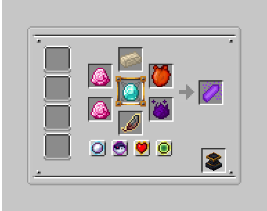
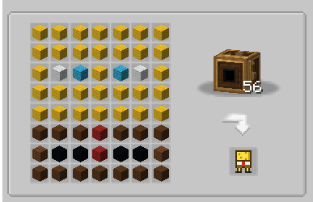
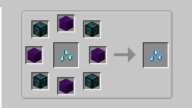
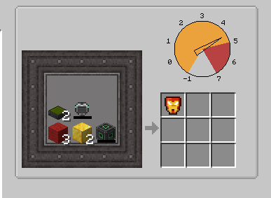
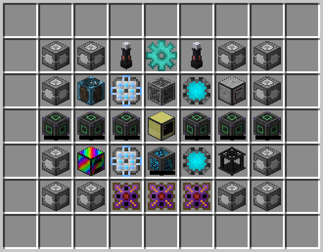

# Final Items

The endgame components of the TitanMods modpack (10 in total). They are part of **Titan Utilities**, the TitanMods companion mod (requires TitanOres). They are the ingredients of the final crafts in
the [Titan Crafter](titan-crafter.md).

!!! info "Recipes"
    Recipes that only use vanilla and TitanOres items are part of the mod; recipes with items from other mods are
    added by the modpack with KubeJS. Each section below shows its recipe once it exists.

| Item | Id | How to get |
|---|---|---|
| { .mc-inline } [Source Crystal](#source-crystal) | `titanutilities:source_crystal` | Hephaestus Forge ritual (Forbidden & Arcanus) |
| { .mc-inline } [Sponge Bob](#sponge-bob) | `titanutilities:sponge_bob` | Create Mechanical Crafters |
| { .mc-inline } [Ancestral Seed](#ancestral-seed) | `titanutilities:ancestral_seed` | Infusion Altar (Mystical Agriculture) |
| { .mc-inline } [World Core](#world-core) | `titanutilities:world_core` | Crafted in the modpack |
| { .mc-inline } [Raid King](#raid-king) | `titanutilities:raid_king` | Max Bad Omen raid drop |
| { .mc-inline } [Antenna](#antenna) | `titanutilities:antenna` | Crafted in the modpack |
| { .mc-inline } [Calculator](#calculator) | `titanutilities:calculator` | Crafted in the modpack |
| { .mc-inline } [Iron Man Mask](#iron-man-mask) | `titanutilities:iron_man_mask` | Pressure Chamber (5.0 bar) |
| { .mc-inline } [Titanium Music Disc](#music-disc-titanium) | `titanutilities:music_disc_titanium` | Titan Crafter |
| { .mc-inline } [Universal Remote](#universal-remote) | `titanutilities:universal_remote` | Titan Crafter (200M FE) |

## Source Crystal { #source-crystal }

{ .mc-inline } `titanutilities:source_crystal`

Made with a **Hephaestus Forge ritual** (Forbidden & Arcanus), forge **tier 3 or higher**:



| Place | Item |
|---|---|
| Forge (center) | Diamond |
| Pedestals (any order) | Gaia Ingot (Botania), any Dragon Heart (Ice and Fire: fire, ice or lightning), Insanium Essence (Mystical Agradditions), Magic Map Focus (Twilight Forest), 2 Dragonstone (Botania) |

| Essence | Amount |
|---|---|
| Aureal | 600 |
| Souls | 8 |
| Blood | 20,000 |
| Experience | 350 |

The essence amounts are above the tier 2 limits, so the ritual needs a tier 3+ forge.

## Sponge Bob { #sponge-bob }

{ .mc-inline } `titanutilities:sponge_bob`

Made with **Create Mechanical Crafters** in a **7x8 grid** (recipe added by the modpack with KubeJS):



| Key | Item | Amount |
|---|---|---|
| A | Yellow Wool | 31 |
| B | Light Blue Wool | 2 |
| C | White Wool | 2 |
| D | Brown Concrete | 13 |
| E | Red Wool | 2 |
| F | Brown Wool | 2 |
| G | Black Concrete | 4 |

## Ancestral Seed { #ancestral-seed }

{ .mc-inline } `titanutilities:ancestral_seed`

Made on the Mystical Agriculture **Infusion Altar** (recipe added by the modpack with KubeJS):



| What you need | Amount | Where |
|---|---|---|
| { .mc-inline } Emberite Seeds | 1 | on the altar |
| { .mc-inline } Emberium Block | 4 | pedestals |
| Insanium Block | 4 | pedestals |
| Infusion Crystal (or Master Infusion Crystal) | — | right-click the altar to start |

## World Core { #world-core }

{ .mc-inline } `titanutilities:world_core`

Crafted in the modpack (KubeJS). Recipe coming soon.

## Raid King { #raid-king }

{ .mc-inline } `titanutilities:raid_king`

**How to get:** dropped when the **last raider** of a raid started with the **highest Bad Omen level** (V in vanilla)
dies and the raid is won. Every such raid drops one, so it can be farmed (a player has to stay nearby to keep the raid
loaded).

**Effect:** worn on the head (helmet slot or the Curios **head** slot) it gives **endless Hero of the Village V** (or
the highest level if a mod raises the Bad Omen cap). It has no armor value.

In game, open the crown in **JEI** (R or U): an **Information** page explains how to get it.

## Antenna { #antenna }

{ .mc-inline } `titanutilities:antenna`

Crafted in the modpack (KubeJS). Recipe coming soon.

## Calculator { #calculator }

{ .mc-inline } `titanutilities:calculator`

Crafted in the modpack (KubeJS). Recipe coming soon.

## Iron Man Mask { #iron-man-mask }

{ .mc-inline } `titanutilities:iron_man_mask`

Made in the **PneumaticCraft Pressure Chamber** at **5.0 bar** (recipe added by the modpack with KubeJS). Drop all the
items into the pressurized chamber; their order does not matter.



| Item | Mod | Amount |
|---|---|---|
| Red Wool | Minecraft | 3 |
| Block of Gold | Minecraft | 2 |
| Solar Panel VII | Solar Flux Reborn | 2 |
| Ultimate Energy Cube | Mekanism | 1 |
| MekaSuit Helmet | Mekanism | 1 |

## Titanium Music Disc { #music-disc-titanium }

{ .mc-inline } `titanutilities:music_disc_titanium`

Made in the [Titan Crafter](titan-crafter.md): **36 Titanium Ingots** around **any music disc** in the center,
using **36,000,000 FE** over 60 seconds.

<div class="recipes">
--8<-- "recipes/music_disc_titanium_from_titan_crafter.html"
</div>

## Universal Remote { #universal-remote }

{ .mc-inline } `titanutilities:universal_remote`

Made in the [Titan Crafter](titan-crafter.md) with **200,000,000 FE** (a full machine) over **5 minutes** (recipe
added by the modpack with KubeJS). Every item must be in its exact slot:



| Key | Item | Mod | Amount |
|---|---|---|---|
| F | Supreme Machine Frame | Industrial Foregoing | 12 |
| E | Ultimate Energy Cube | Mekanism | 6 |
| W | Wyvern Energy Controller | Draconic Evolution | 3 |
| A | 64k ME Storage Component | Applied Energistics 2 | 2 |
| P | 64k Storage Part | Refined Storage | 2 |
| R | Energizing Rod (Nitro) | Powah | 2 |
| G | Diamond Gear | any mod (`#forge:gears/diamond`) | 1 |
| L | Logic Programmer | Integrated Dynamics | 1 |
| M | ME Controller | Applied Energistics 2 | 1 |
| O | Modular Router | Modular Routers | 1 |
| C | Advanced Computer | CC: Tweaked | 1 |
| B | Rainbow Furnace | Iron Furnaces | 1 |
| S | Controller | Refined Storage | 1 |
| X | Flux Controller | Flux Networks | 1 |

```
         
 FFRGRFF 
 FLAMPOF 
 EEECEEE 
 FBASPXF 
 FFWWWFF 
         
```
