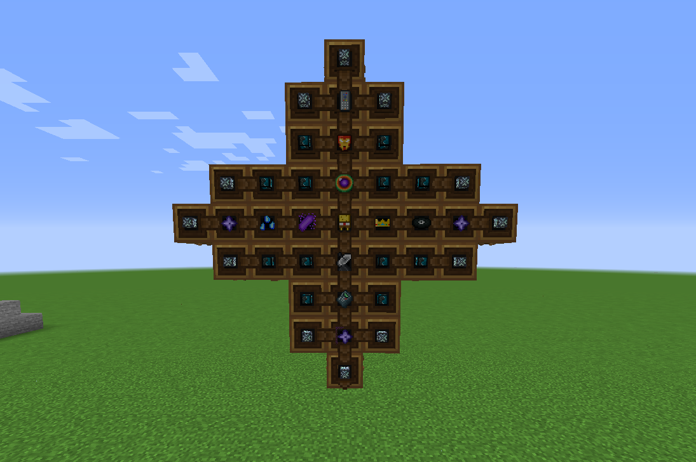

{ .ts-cover-img }

<h1 class="ts-rainbow">Titan Star</h1>

Can you make the Titan Star?

{ .ts-icon }

The **Titan Star** is the last and rarest of the [final items](final-items.md) of **TitanMods**. It never stops
shining: it always carries the enchantment glint, and its name cycles through every color of the rainbow, letter by
letter.

**Id**
`titanutilities:titan_star`

**Mod**
Titan Utilities

**Rarity**
Epic, always enchanted

**How to get**
Create Mechanical Crafters (9x9)

## The challenge

Every other final item asks you to master a different part of the modpack: rituals, automation, magic, raids and
huge amounts of energy. The Titan Star is meant to be the crown of that journey. Master the ores, the machines and the
final items of TitanMods: only a player who has made every one of them can build the [crafter](#recipe) that forges
the star.

## Recipe { #recipe }

Made with a **9x9 cross of Create Mechanical Crafters** (recipe added by
the modpack with KubeJS). It takes **all 10 final items** at once, surrounded by Titanium Stars, Emberium Blocks and
Compressed Nether Star Blocks (1x). Every item must be in its exact crafter.

{ .ts-shot }

| Item | Mod | Amount |
|---|---|---|
| Compressed Nether Star Block (1x) | AllTheCompressed | 12 |
| { .mc-inline } Emberium Block | TitanOres | 12 |
| { .mc-inline } Titanium Star | TitanOres | 3 |
| { .mc-inline } Universal Remote | Titan Utilities | 1 |
| { .mc-inline } Iron Man Mask | Titan Utilities | 1 |
| { .mc-inline } World Core | Titan Utilities | 1 |
| { .mc-inline } Sponge Bob | Titan Utilities | 1 |
| { .mc-inline } Antenna | Titan Utilities | 1 |
| { .mc-inline } Calculator | Titan Utilities | 1 |
| { .mc-inline } Ancestral Seed | Titan Utilities | 1 |
| { .mc-inline } Source Crystal | Titan Utilities | 1 |
| { .mc-inline } Raid King | Titan Utilities | 1 |
| { .mc-inline } Titanium Music Disc | Titan Utilities | 1 |
