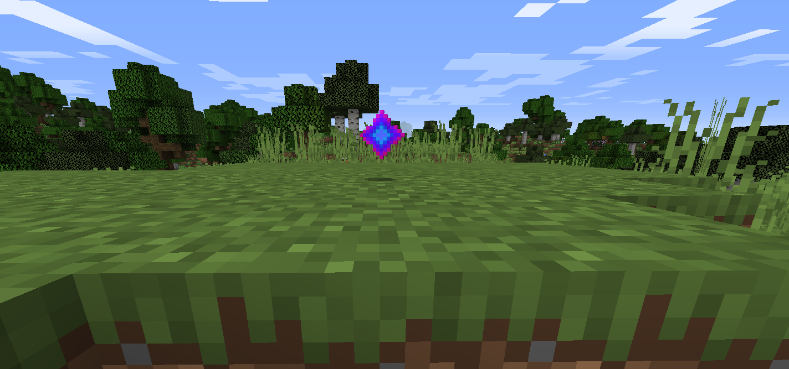

{ .ts-cover-img }

<h1 class="ts-rainbow">Titan Star</h1>

Can you make the Titan Star?

{ .ts-icon }

The **Titan Star** is the last and rarest of the [final items](final-items.md) of **TitanMods**. It never stops
shining: it always carries the enchantment glint, and its name cycles through every color of the rainbow, letter by
letter.

**Id**
`titanutilities:titan_star`

**Mod**
Titan Utilities

**Rarity**
Epic, always enchanted

**How to get**
Recipe coming soon

## The challenge

Every other final item asks you to master a different part of the modpack: rituals, automation, magic, raids and
huge amounts of energy. The Titan Star is meant to be the crown of that journey. Master the ores, the machines and the
final items of TitanMods, and get ready: when its recipe is revealed, only the strongest players will be able to make
one.

## Recipe { #recipe }

!!! info "Coming soon"
    The Titan Star recipe has not been revealed yet. It will be shown here, with its JEI screenshot, as soon as it is
    added.
